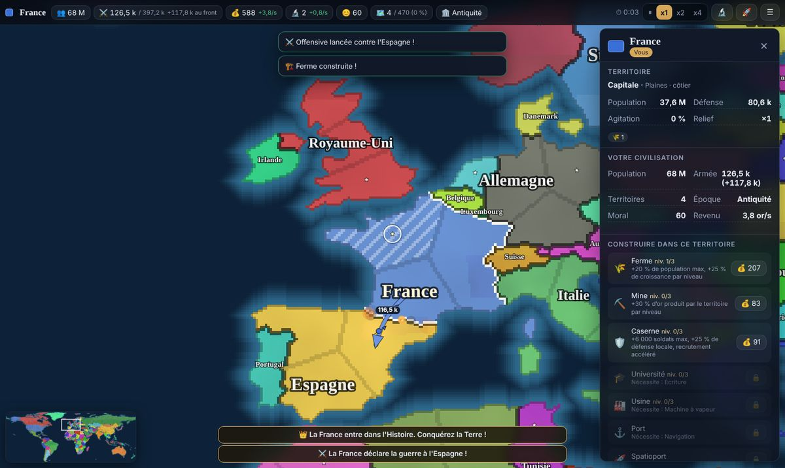
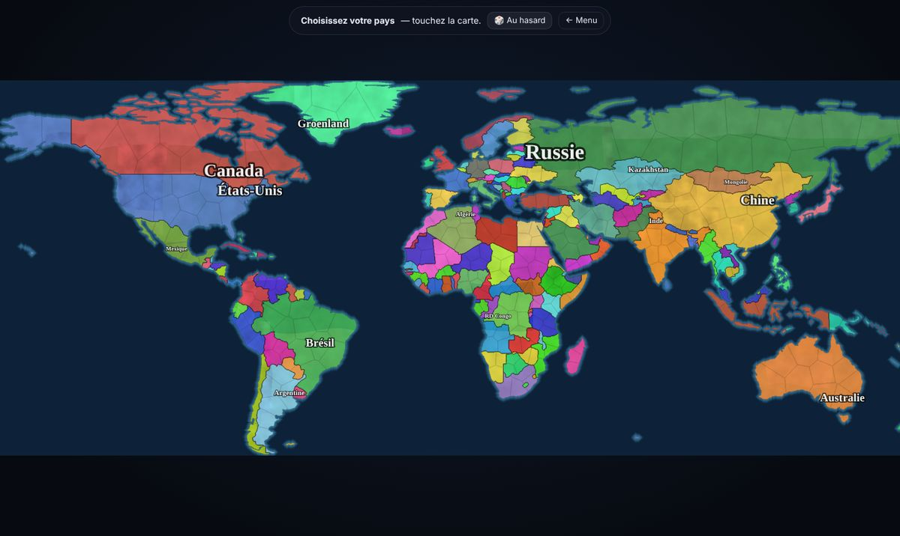
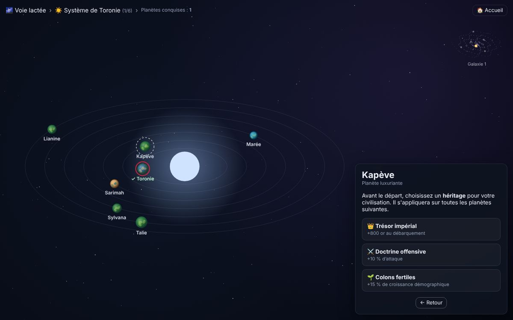
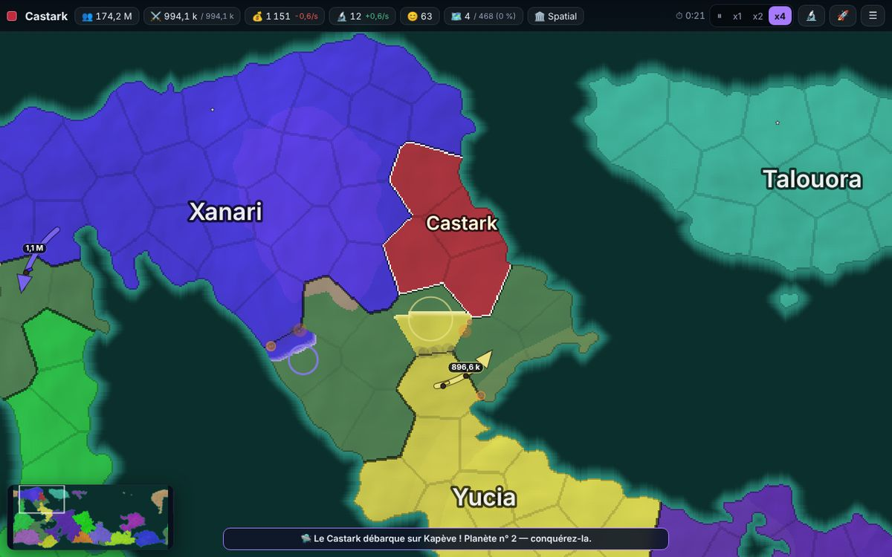

# 🌍 Terra Conquest

Jeu de stratégie en temps réel, jouable dans le navigateur, inspiré des vidéos « country battles » : les pays s'affrontent sur une carte, les frontières bougent en direct et la couleur de l'attaquant « dévore » les territoires adverses. Vous partez d'un pays, conquérez le monde, faites progresser votre civilisation de l'Antiquité à l'ère spatiale, puis vous lancez à l'assaut d'autres planètes. Le jeu ne s'arrête jamais.

- **100 % statique** : HTML, CSS et JavaScript (modules ES natifs). Aucune étape de build, aucun backend, aucune dépendance externe : la carte du monde est fournie dans `data/`, le bruit Simplex, le décodeur TopoJSON et le découpage en territoires sont écrits à la main.
- **Interface en français**, thème sombre, jouable à la souris et au doigt (toucher, glisser, pincer).



| Choix du pays | Système solaire | Planète luxuriante |
|---|---|---|
|  |  |  |

---

## 🎮 Comment jouer

### Démarrer une partie
1. **Terre réelle** : les 176 pays du monde (données Natural Earth), avec leur population, leur niveau de développement et leur capitale. Le curseur « Pays IA » permet de n'en garder que les N plus peuplés : les autres deviennent des *terres libres*.
2. **Monde procédural** : un monde généré à partir d'une **graine** (bruit Simplex pour les continents, découpage en territoires, noms et couleurs aléatoires). Le bouton 🔗 copie un lien de partage (`?seed=…&type=…`) qui régénère exactement le même monde.
3. Choisissez la difficulté (Facile → Impossible) et la vitesse initiale, puis **touchez un pays** : sa population, son armée, son revenu et une **difficulté estimée** s'affichent avant de valider.

### Conquête (phase 2)
- La simulation tourne en temps réel : **⏸ / x1 / x2 / x4**.
- Touchez un territoire étranger : choisissez le **% de votre armée** à engager, consultez le **rapport de force estimé**, puis **Attaquer**. L'offensive avance territoire par territoire en direction du territoire visé ; chaque conquête laisse une garnison, si bien qu'une offensive finit toujours par s'essouffler.
- Votre **réserve** défend vos frontières : tout engager au même endroit vous rend vulnérable.
- Les montagnes, jungles, capitales et territoires historiques (patriotisme) se défendent mieux. Les attaques **navales** demandent la Navigation et subissent un malus (réduit par les ports et certaines technologies).
- Diplomatie : proposer la paix ou une alliance, exiger une reddition, rompre une alliance. Les IA déclarent des guerres, s'allient, trahissent, font la paix, **capitulent** quand elles sont trop faibles, et forment une **coalition** si vous devenez trop dominant.
- **Événements aléatoires** : révoltes (qui peuvent ressusciter un pays disparu), épidémies, ruées vers l'or, découvertes, âges d'or, catastrophes propres à chaque planète.
- **Victoire planétaire** à 100 % des territoires ; **défaite** si vous perdez votre dernier territoire.

### Civilisation (phase 3)
- La population produit de l'**or** 💰, de la **recherche** 🔬 et des **soldats** ⚔️ (avec rendements décroissants : un empire géant reste fragile). Les territoires fraîchement conquis sont agités et moins productifs.
- **Bâtiments** par territoire : ferme, mine, caserne, université, usine, port, spatioport.
- **Arbre technologique** : Antiquité → Médiéval → Industriel → Moderne → Spatial (4 technologies d'une époque débloquent la suivante). Chaque époque multiplie l'efficacité des soldats et change le style des unités et de l'interface. Une fois à l'ère spatiale, des **technologies infinies** restent disponibles.
- L'or en excès peut servir à recruter des **mercenaires**.

### Conquête spatiale (phase 4)
- Pour quitter une planète : **100 % des territoires + époque spatiale + Colonisation spatiale + spatioport + fusée** (bouton 🚀 Objectifs).
- La vue **système solaire** présente des planètes générées procéduralement : désertique, océanique (combats navals), glaciaire (offensives ralenties), volcanique (mers de lave), géante gazeuse (stations flottantes, combats aériens), luxuriante… Chacune a sa palette, ses règles et ses catastrophes.
- Avant chaque départ, choisissez un **héritage** (bonus permanent). Vos technologies et héritages sont conservés d'une planète à l'autre ; vous débarquez avec une force expéditionnaire sur le site de votre choix.
- **Difficulté infinie** : chaque planète compte plus de territoires, plus de civilisations, plus avancées et plus riches. Après 6 systèmes, saut vers une nouvelle galaxie.

### Commandes
| Action | Souris / clavier | Tactile |
|---|---|---|
| Sélectionner | clic | toucher |
| Déplacer la carte | glisser | glisser |
| Zoomer | molette, double-clic | pincer |
| Pause / vitesses | `Espace`, `1` `2` `3` | boutons ⏸ x1 x2 x4 |
| Technologies | `T` | 🔬 |
| Recentrer sur votre pays | `F` ou clic sur votre nom | toucher votre nom |
| Afficher/masquer les noms | `L` | menu ☰ |
| Menu | `Échap` | ☰ |

La partie est **sauvegardée automatiquement** (localStorage) toutes les 30 secondes et quand vous quittez l'onglet. Le menu ☰ permet d'**exporter** la sauvegarde en fichier `.json`, que l'on peut **importer** depuis l'écran d'accueil (sur un autre appareil, par exemple).

---

## 💻 Lancer en local

Les modules ES ne fonctionnent pas en `file://` : il faut un petit serveur HTTP statique.

```bash
git clone https://github.com/lucasbegellb-design/Planetconquest.git
cd Planetconquest
python3 -m http.server 8080        # ou : npx serve .
```

Puis ouvrez <http://localhost:8080>.

## 🚀 Déployer sur GitHub Pages

Aucun build n'est nécessaire : le jeu est servi tel quel depuis la racine du dépôt.

1. Poussez le code sur la branche `main` (fusionnez la branche de travail si besoin).
2. Sur GitHub : **Settings → Pages**.
3. **Source** : *Deploy from a branch* ; **Branch** : `main`, dossier **`/ (root)`** ; **Save**.
4. Après une minute, le jeu est en ligne sur `https://lucasbegellb-design.github.io/Planetconquest/`.

Le fichier `.nojekyll` désactive le traitement Jekyll (inutile ici). Tous les chemins sont relatifs : le jeu fonctionne aussi bien à la racine d'un domaine que dans un sous-dossier.

---

## 🧱 Architecture

```
index.html              page unique (écrans : accueil, chargement, choix, jeu, espace)
css/style.css           thème sombre + variantes visuelles par époque (body[data-era])
data/countries-110m.json  world-atlas 110m (Natural Earth), embarqué
js/
  main.js               orchestration : écrans, boucle de jeu, sauvegarde, transitions
  core/                 rng (graines), noise (Simplex 3D sur cylindre), heap, util, fr (grammaire)
  map/                  génération et rendu
    earthData.js        176 pays : nom FR, article, population, développement, capitale
    topojson.js         décodage TopoJSON + remplissage de polygones par balayage
    cells.js            découpage raster en territoires contigus, voisinages, routes maritimes
    earth.js            carte « Terre réelle » (projection équirectangulaire cyclique)
    procedural.js       planètes procédurales (relief, biomes, civilisations)
    planetTypes.js      7 types de planètes : palettes, biomes, règles, catastrophes
    biomes.js, names.js, colors.js, mapCommon.js
    paint.js            peinture pixel du raster (frontières, sélection, terrain)
    renderer.js         rendu canvas : animations de conquête, fronts, étiquettes, mini-carte
    camera.js           caméra + souris/tactile (tap, glisser, pincer, molette)
  sim/                  simulation pure (sans DOM : testable en Node)
    game.js             état, économie, offensives, captures, diplomatie, sérialisation
    ai.js               décisions des IA (attaque, défense, paix, alliances, redditions)
    events.js           événements aléatoires
    balance.js          constantes d'équilibrage et niveaux de difficulté
  tech/                 techtree.js (5 époques + répétables), buildings.js
  space/                progression.js (méta-progression, difficulté infinie), spaceView.js
  ui/                   menu, HUD, panneau, arbre techno, aide, sauvegarde, utilitaires DOM
tests/                  simulations headless (Node) et tests navigateur (Playwright)
```

### Choix techniques
- **Rendu raster** (à la manière de territorial.io) : chaque planète est une grille de pixels → identifiant de territoire. La carte entière est un seul canvas hors-écran dessiné en un `drawImage` par image (seule la partie visible est copiée, en demi-résolution quand on est dézoomé), quel que soit le nombre de territoires. Une conquête repeint le territoire **pixel par pixel en partant du front** (parcours en largeur), avec un liseré lumineux : c'est l'effet « la couleur mange le territoire ».
- **Territoires** : k-means puis inondation priorisée par la distance (Voronoï contraint) dans chaque pays et chaque masse terrestre → territoires contigus aux frontières réelles. Les routes maritimes sont calculées par un parcours de l'eau, avec un arbre couvrant (Kruskal) qui garantit qu'aucune île n'est inaccessible.
- **Carte cyclique** : projection cylindrique pour la Terre, bruit 3D échantillonné sur un cylindre pour les planètes → on fait le tour du monde sans couture.
- **Simulation indépendante du rendu** (pas fixe de 0,1 s), ce qui permet de l'équilibrer en Node avec un joueur automatique.

## 🗺️ Plan de développement (étapes réalisées)
1. Génération des cartes (Terre réelle + procédurale) — testée en Node avec aperçus PNG.
2. Simulation : économie, offensives, IA, événements — équilibrée avec un bot headless.
3. MVP jouable : rendu, caméra, accueil, choix du pays, HUD, panneau, fil d'actualité.
4. Civilisation : arbre technologique, bâtiments, thèmes par époque, fusée.
5. Conquête spatiale : système solaire, types de planètes, héritages, galaxies infinies.
6. Sauvegarde/export/import, optimisation (60 fps), version mobile, tests Playwright.

## ⚖️ Équilibrage

Mesuré avec le joueur automatique (`tests/bot.mjs`), difficulté Normale, temps de jeu en x1 :

| Scénario | Résultat |
|---|---|
| Terre, France (5 graines) | 4 conquêtes entre 19 et 28 min, 1 défaite face à l'alliance Chine–Inde |
| Terre, Brésil / Allemagne | 27 min / 26 min |
| Terre, Chine (géant de départ) | ≈ 12 min — choix « facile » |
| Terre, Japon / Belgique | défaites (17 min / 7 min) — choix difficiles |
| Planètes de niveau 1 à 3 | conquises en 7 à 32 min |
| Planètes de niveau 4 à 8 (technologies infinies accumulées) | 10 à 18 min, environ une défaite sur quatre |

Un joueur humain, moins systématique que le bot, met typiquement 25 à 40 minutes pour conquérir la Terre. Toutes les constantes sont regroupées dans `js/sim/balance.js` et `js/space/progression.js`.

## 🧪 Tests

```bash
node tests/genmap.mjs earth                     # génère la Terre + aperçu PNG
node tests/genmap.mjs proc maGraine ocean       # planète procédurale
node tests/sim.mjs 30 France bot                # 30 min simulées avec le joueur automatique
node tests/space-sim.mjs 3                      # planète extraterrestre de niveau 3 (REP=2.5 : technologies infinies)
# tests navigateur (Playwright + Chromium, serveur local sur :8080)
node tests/browser.cjs                          # partie Terre, interactions UI, fps
node tests/browser.cjs http://localhost:8080/ /tmp mobile
node tests/browser-space.cjs                    # fusée → système → héritage → atterrissage → reprise
node tests/browser-perf.cjs                     # performances (fin de partie, planète de 900 territoires)
```

## 📜 Crédits
- Données géographiques : [Natural Earth](https://www.naturalearthdata.com/) (domaine public) via [world-atlas](https://github.com/topojson/world-atlas) (ISC).
- Bruit Simplex d'après l'algorithme de Stefan Gustavson (domaine public).
